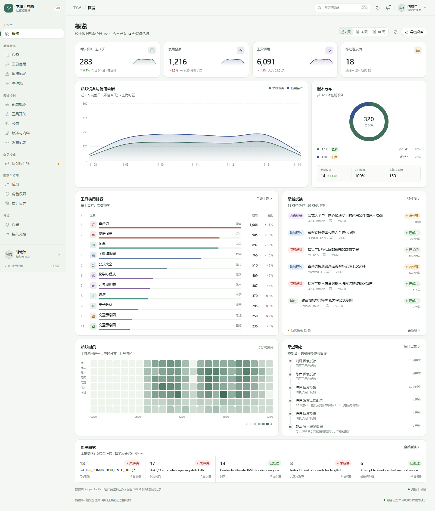
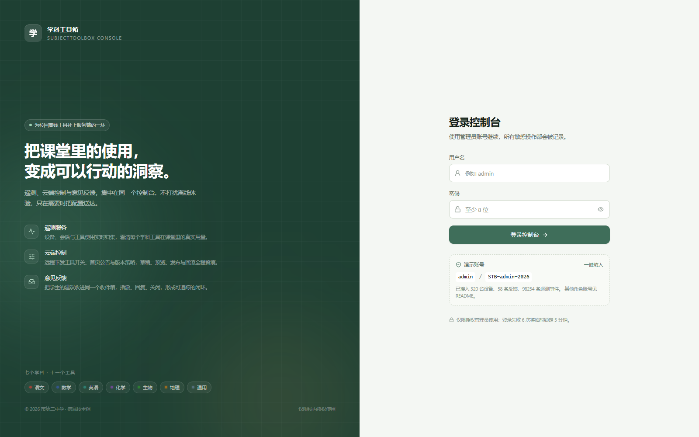
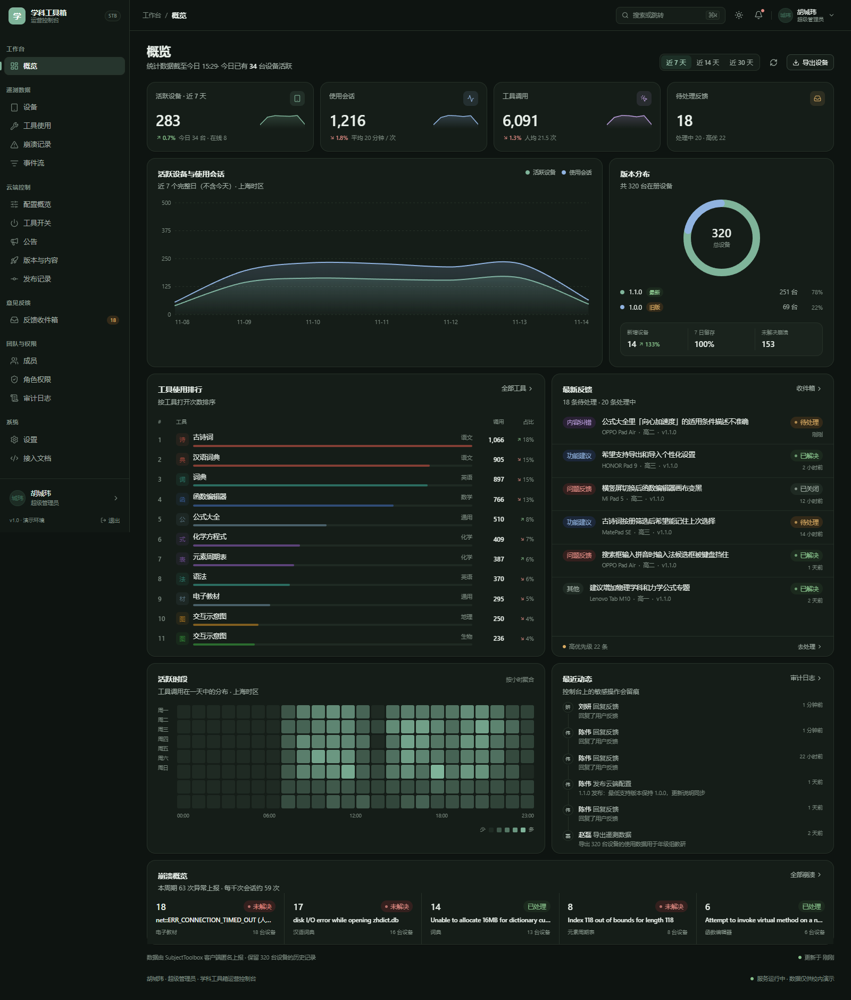
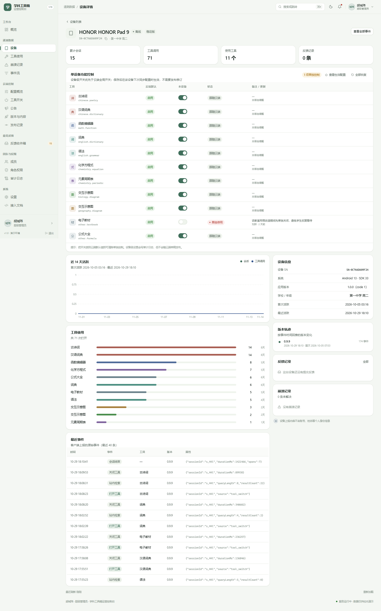
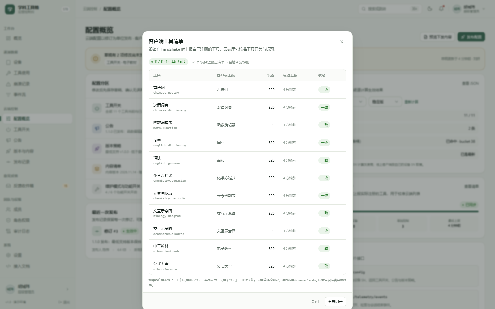
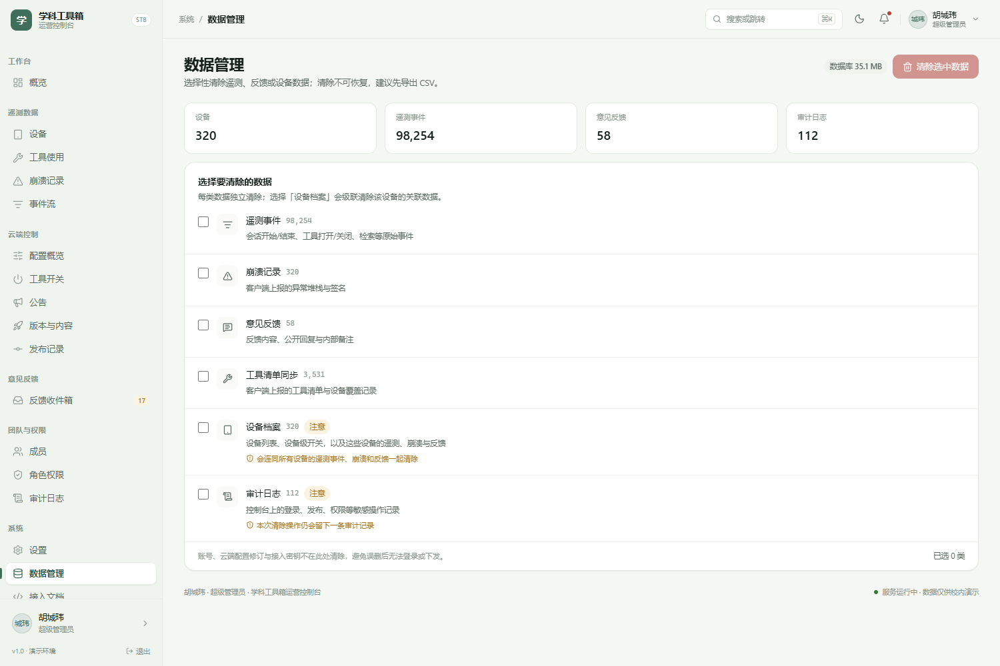

# 学科工具箱 · 运营控制台

> SubjectToolbox Console —— 为「学科工具箱 SubjectToolbox」提供**遥测服务、云端控制、意见反馈与账号权限**的独立后台。

后台与 STB 客户端通过一组极小的 HTTP 接口连接，所有设备**统一以 SN 标识**（遥测、配置、反馈、设备级开关都使用同一个 SN）。
本仓库只包含后台服务与控制台；STB 的接入改动（SN、节流队列、设置页反馈、云端工具同步）在 STB 仓库中单独维护。
演示数据、截图和账号都是合成的，不含真实学生信息。



## 功能

| 模块 | 能力 |
| --- | --- |
| 概览 | 活跃设备 / 会话 / 工具调用 / 待处理反馈、趋势图、版本分布、工具排行、活跃时段热力图、崩溃 Top 5、最新反馈与审计动态 |
| 遥测 · 设备 | 320 台平板的 SN、装机、在线状态、版本、学校年级、会话与调用次数；搜索与多维筛选；单机详情（活跃曲线、工具偏好、版本轨迹、事件、反馈、崩溃） |
| 遥测 · 工具 | 7 学科 11 个主工具的调用量、覆盖设备、占比、环比与关联崩溃；学科分布与卡片式排行（示意图子项与反馈入口不参与排行） |
| 遥测 · 崩溃 | 按异常签名聚合、未解决/已处理流转、堆栈详情、影响设备与版本分布；一键标记处理 |
| 遥测 · 事件流 | 原始事件分页、按事件名/工具/设备/时间筛选，props 预览；设备与工具下钻 |
| 云端控制 | 工具开关（14 项受管控条目：11 个主工具 + 2 个示意图子项 + 意见反馈；逐项启停、最低版本、渠道、**停用原因**）、**单设备功能开关（含单设备停用原因）**、公告排期、版本策略、内容灰度、维护模式、功能开关；停用的工具在客户端仍显示（置灰并标注已停用），点击弹停用原因 |
| 草稿与发布 | 草稿保存、差异摘要、客户端生效预览（含 JSON）、发布修订、历史回滚；每次发布写入审计日志 |
| 工具清单同步 | 客户端握手时上报自己注册的全部条目（14 项受管控条目），后台展示同步覆盖率、标题差异与未登记工具；设备级开关按同一份工具 ID 生效 |
| 意见反馈 | 收件箱、状态流转、优先级、负责人、标签、公开回复与内部备注、设备信息、客户端进度查询 |
| 账号与权限 | 创建账号、5 种角色、15 项权限、启停、重置密码、删除；权限矩阵可视化；审计日志 |
| 系统设置 | 工作区信息、采集与反馈开关、匿名上报、留存策略、接入密钥轮换、演示数据重建（仅开发/演示模式） |
| 生产模式 | `STB_ENV=production`（或 `NODE_ENV=production`）：不播种演示数据、不显示演示账号、不允许重建演示数据；首次启动创建管理员与客户端密钥并写入 `data/initial-admin.txt`、`data/initial-client-key.txt`。完整步骤见 [docs/DEPLOYMENT.md](./docs/DEPLOYMENT.md) |
| 数据管理 | 按类别清除遥测事件、崩溃、反馈、工具清单同步、设备档案与审计日志；二次确认、审计留痕、清除后 VACUUM 收缩数据库 |
| 接入文档 | 客户端握手、事件、崩溃、配置、反馈接口的 curl 示例与 Android 参考实现 |

| 登录 | 深色模式 |
| --- | --- |
|  |  |

| 单设备功能控制 | 工具清单同步 |
| --- | --- | --- |
|  |  |

| 数据管理 |
| --- |
|  |

## 技术栈

| 层 | 选择 |
| --- | --- |
| 运行时 | Node.js 24（内置 `node:sqlite`，零原生依赖） |
| 服务端 | Fastify 5 + `@fastify/cookie` + `@fastify/static`，TypeScript + tsx |
| 数据库 | SQLite（WAL），单文件 `data/console.db`，不需要外部数据库 |
| 前端 | React 19 + Vite 7 + TypeScript |
| 样式 | Tailwind CSS 4 + CSS 变量主题，自有组件库与 SVG 图表，无图表依赖 |
| 图标 | Lucide（ISC License） |
| 鉴权 | 服务端 Session Cookie（HttpOnly、7 天，生产模式自动 `Secure`）、scrypt 口令、登录限流；客户端使用 `X-STB-Key` |

## 快速开始

前置：Node.js 24+（必须，`node:sqlite` 从 22.5 起提供，24 上可直接使用；本机 Node 22.14 实测也可运行）、pnpm 10+。

```bash
pnpm install

# 可选：生成本地环境变量文件（仓库根目录 .env，已 gitignore；模板见 .env.example）
cp .env.example .env
# Windows PowerShell：Copy-Item .env.example .env

# 开发模式：API 8787 + Vite 5173（已配置 /api、/v1 代理）
pnpm dev
# 打开 http://127.0.0.1:5173

# 生产模式：构建前端并由 API 服务托管（不播种演示数据，详见 docs/DEPLOYMENT.md）
pnpm build
pnpm start
# 打开 http://127.0.0.1:8787

# 生产模式（不播种演示数据、不显示演示账号）
STB_ENV=production pnpm start
# Windows PowerShell 写法：$env:STB_ENV='production'; pnpm start
```

其他命令：

```bash
pnpm seed        # 清空并重建演示数据（仅开发模式；生产模式会拒绝执行）
pnpm typecheck   # 服务端 + 前端 TypeScript 检查
pnpm screenshot  # 用本机 Edge 截取各页面（开发自检用）
```

环境变量：`PORT`（默认 `8787`）、`HOST`（默认 `127.0.0.1`）、`STB_ENV` / `NODE_ENV`（设为 `production` 开启生产模式）、`STB_DATA_DIR`（数据目录，默认 `data/`）。
所有环境变量也可以写在**仓库根目录的 `.env`** 里（启动时读取一次，参考 `.env.example`）：`.env` 已 gitignore、不要提交；**系统环境变量（shell / systemd / Docker）优先于 `.env`**，改完 `.env` 需要重启服务。
数据文件与上传目录会自动创建在数据目录下；开发模式下首次启动检测到空库会自动播种演示数据，**生产模式不播种**。

### 演示账号（仅开发/演示模式）

> 下表账号只在**开发/演示模式**（未设置 `STB_ENV=production`）首次启动播种时存在，仅用于本机演示。
> 生产模式**不会**创建这些账号：首次启动只创建 1 个 owner 账号，账号与初始密码写在 `data/initial-admin.txt`，客户端密钥写在 `data/initial-client-key.txt`（见 [docs/DEPLOYMENT.md](./docs/DEPLOYMENT.md)）。

| 角色 | 用户名 | 密码 | 说明 |
| --- | --- | --- | --- |
| 超级管理员 | `admin` | `STB-admin-2026` | 全部权限，含密钥与演示数据重置 |
| 管理员 | `chenwei` | `STB-admin-2026` | 可发布配置、管理成员，不能操作接入密钥 |
| 运营专员 | `liuyan` | `STB-team-2026` | 处理反馈、编辑草稿，不能发布 |
| 数据分析师 | `zhaolei` | `STB-team-2026` | 只读遥测/反馈，可导出 CSV |
| 只读成员 | `wangjing` | `STB-team-2026` | 只能查看概览、遥测、配置与反馈 |

登录页提供「一键填入」演示账号（`/api/public/meta` 返回 `demoAccount` 时才显示）。客户端上报密钥在 `data/seed-credentials.txt`（每次重置演示数据会重新生成，仅开发模式）。

## 权限模型

权限点按「域.动作」命名，服务端每个写接口都会显式校验；前端只负责隐藏无权限的入口。

| 角色 | 权限 |
| --- | --- |
| 超级管理员 `owner` | 全部 15 项 |
| 管理员 `admin` | 概览、遥测（含导出）、配置查看/编辑/发布、反馈全部、成员管理、审计、系统设置 |
| 运营专员 `operator` | 概览、遥测查看、配置查看/编辑、反馈查看/回复/管理、成员查看 |
| 数据分析师 `analyst` | 概览、遥测查看/导出、配置查看、反馈查看、审计查看 |
| 只读成员 `viewer` | 概览、遥测查看、配置查看、反馈查看 |

权限点：`dashboard.view`、`telemetry.view`、`telemetry.export`、`telemetry.manage`、`config.view`、`config.edit`、`config.publish`、
`feedback.view`、`feedback.reply`、`feedback.manage`、`users.view`、`users.manage`、`audit.view`、
`settings.manage`、`keys.manage`。完整矩阵见「团队与权限 → 角色权限」。

账号规则：用户名唯一且不可修改；初始密码只在创建时展示一次；停用账号会清理所有会话；
只有超级管理员能授予/修改超级管理员、删除账号；系统始终保留至少一个可用超级管理员。

## 云端配置

远程配置是一份 JSON 文档，包含：

```jsonc
{
  "maintenance": { "enabled": false, "message": "", "startAt": null, "endAt": null },
  "release": {
    "latestVersion": "1.1.0", "latestVersionCode": 2,
    "minSupportedVersion": "1.0.0", "forceUpdate": false,
    "updateNotes": "…"
  },
  "content": { "version": "2026.11.14", "rollout": 100, "notes": "…" },
  "tools": [
    { "toolId": "chinese.poetry", "enabled": true, "minVersion": "1.0.0",
      "channels": ["stable", "beta"], "disabledReason": "" },
    { "toolId": "other.textbook", "enabled": false, "minVersion": "1.0.0",
      "channels": ["stable", "beta"], "disabledReason": "教室网络改造，暂停使用电子教材" }
  ],
  "announcements": [
    { "id": "ann-001", "title": "…", "body": "…", "level": "info",
      "channels": ["stable"], "enabled": true, "pinned": true,
      "startAt": "2026-11-14T00:00:00.000Z", "endAt": "2026-12-15T00:00:00.000Z" }
  ],
  "features": [{ "key": "telemetry.enabled", "enabled": true, "description": "…" }]
}
```

编辑写入草稿，发布时生成一条**只追加**的修订；回滚会把旧修订内容以新修订号重新发布，历史不丢。
`/v1/config` 会按客户端的 `version`、`channel`、`sn` 计算生效结果：

- 工具：同时满足启用、渠道命中、版本 ≥ 最低版本；如果该 SN 在后台被单独设置过，**设备级开关优先**；被停用的工具在 `enabled=false` 时下发 `disabledReason` 与 `disabledReasonSource`（仅确有原因文案时），客户端据此置灰并在点击时弹窗；
- 公告：启用、渠道命中、在时间窗内、版本满足；
- 内容：按设备 SN 的 SHA-1 取模分桶，命中灰度比例才下发；
- 维护模式：按时间窗计算；
- 版本：给出 `updateAvailable` / `updateRequired`，客户端只提示「请通过应用市场更新」，不使用下载地址。

### 停用原因（全局 + 单设备）

停用一项工具 / 示意图子项 / 反馈入口时，可以给用户一句说明：

| 级别 | 后台位置 | 配置字段 | 生效方式 |
| --- | --- | --- | --- |
| 全局 | 云端控制 → 工具开关 →「停用原因（全局）」 | `tools[].disabledReason`（0–120 字，留空用默认文案） | 保存草稿并**发布配置**后下发 |
| 单设备 | 设备详情 → 单设备功能控制 →「停用原因（本设备）」 | 单设备覆盖的 `reason`（≤120 字） | 保存后该设备下次拉配置即生效，**不需要发布** |

`/v1/config` 下发给客户端时，`tools[toolId]` 里是一条合并后的结果：

```jsonc
"other.textbook": {
  "enabled": false,
  "reason": "device_disabled",
  "source": "device",
  "disabledReason": "教室网络改造，暂停使用电子教材",   // 仅停用且确有原因文案时下发
  "disabledReasonSource": "device"                    // "device"（单设备原因）或 "global"（全局原因）
}
```

- 优先级（服务端已合并好）：**单设备原因 > 全局 `disabledReason` > 客户端默认文案**（「学校管理员暂时关闭了这个工具；你的本地数据不会丢失。」）；
- `disabledReasonSource: "device"` 时客户端会附加「该停用仅针对本设备」，`"global"` 时附加「学校管理员设置」；
- 已启用（`enabled=true`）的工具不携带 `disabledReason` / `disabledReasonSource`；
- 客户端**停用不隐藏**：工具卡片、示意图子项（细胞分裂 / 地球自转）与意见反馈入口都会保留原位、置灰并标注「已停用」，点击弹出停用原因；通过直达链接进入时展示「工具暂不可用」页；
- 后台配置里只有 `disabledReason` 一个原因字段（工具配置不再有旧 `message` 字段）。

给某台设备单独填写停用原因（后台管理接口，需要登录会话；`note` 是内部备注，不下发）：

```jsonc
// PUT /api/devices/:sn/overrides
{ "toolId": "other.textbook", "enabled": false, "reason": "本机考试期间暂停使用", "note": "考试结束后恢复" }
```

「配置概览 → 下发预览」可以切换版本、渠道与修订来源（线上/草稿），直接看到客户端会拿到的 JSON。

### 单设备功能控制

在「设备详情 → 单设备功能控制」里，可以只对一台平板停用或启用某个工具：

- 开关优先于云端全局设置，保存后在该设备下次拉取配置时生效，**不需要发布修订**；
- 可给单设备填写「停用原因（本设备）」（≤120 字）：只在该设备单独停用时生效并优先于全局原因，留空则回退全局停用原因；
- 「备注」是内部备注，永不下发给客户端；保存原因/备注都会写入审计日志（原因截断 60 字）；「全部恢复」清空该设备的全部覆盖；
- 设备列表会给有覆盖的设备标出「N 项单独控制」，设备详情可直接预览该 SN 的完整生效 JSON（含 `disabledReason` / `disabledReasonSource`）。

### 同步与限流

- 后台给客户端的配置里带 `sync` 字段：完整配置最多 6 小时兜底同步一次，遥测最多 10 分钟上报一次，单批最多 200 条；
- **前台短轮询**：客户端在前台时每 `sync.revisionPollMinSeconds`–`revisionPollMaxSeconds` 秒（默认 30–60 秒，每 tick 随机）调用一次轻量接口 `GET /v1/config/revision`，只拿当前修订号；发现与本地不同才走 `/v1/config` 拉全量并更新公告、工具开关与版本提示。退到后台立即停止，不建立 SSE/WebSocket 常驻连接，也不需要厂商推送；
- 服务端按 SN 做内存限流：握手 12 次/小时、事件 30 次/小时、崩溃 20 次/小时、反馈 10 次/小时、修订号轮询 180 次/小时（30 秒一次最坏 120 次/小时，留重试余量）、全局配置 60 次/小时；
- 客户端离线时不发起请求，事件写入有上限的本地队列（800 条 / 512 KB），恢复网络后再补发；
- 版本提示只比较版本号并提示去应用市场，不下载 APK，也不占用额外磁盘。

### 数据清理

「系统 → 数据管理」提供按类别的数据清除，只对拥有 `settings.manage` 的角色可见：

- 可单选/多选遥测事件、崩溃记录、意见反馈、工具清单同步、设备档案、审计日志；
- 「设备档案」会级联清除所有设备的遥测、崩溃、反馈与设备级开关，适合演示环境整体重置；
- 必须输入 `CLEAR` 二次确认，清除后写一条 `system.purge` 审计记录；
- 清除完成后执行 `wal_checkpoint(TRUNCATE)` 与 `VACUUM`，尽量把 SQLite 文件缩回；
- 账号、云端配置修订、接入密钥**不在此处清除**，避免误删后无法登录或下发配置。

## 接口

### 管理端（Cookie 会话）

| 方法 | 路径 | 权限 |
| --- | --- | --- |
| GET | `/api/public/meta` | 公开（生产模式标记、登录页演示账号、数据计数） |
| POST | `/api/auth/login`、`/api/auth/logout` | 公开 / 登录 |
| GET | `/api/me`、`/api/catalog`、`/api/notifications` | 登录 |
| GET | `/api/overview?range=7\|14\|30` | `dashboard.view` |
| GET | `/api/devices`、`/api/devices/:sn`、`/api/events` | `telemetry.view` |
| GET/PUT/DELETE | `/api/devices/:sn/overrides` | `config.view` / `config.edit`（PUT 可带 `reason` / `note`） |
| GET | `/api/tools/sync`、`/api/tools/overrides/summary` | `config.view` |
| GET | `/api/errors`、`/api/errors/detail?signature=` | `telemetry.view` |
| POST | `/api/errors/resolve` | `telemetry.manage` |
| GET | `/api/export/devices.csv`、`/api/export/events.csv` | `telemetry.export` |
| GET | `/api/feedback`、`/api/feedback/stats`、`/api/feedback/:id` | `feedback.view` |
| POST | `/api/feedback/:id/replies` | `feedback.reply` |
| PATCH | `/api/feedback/:id` | `feedback.manage` |
| GET | `/api/config`、`/api/config/preview`、`/api/config/revisions` | `config.view` |
| PUT | `/api/config/draft` | `config.edit` |
| POST | `/api/config/publish`、`/api/config/rollback` | `config.publish` |
| GET/POST/PATCH/DELETE | `/api/users`、`/api/users/:id`、`/api/users/:id/password` | `users.view` / `users.manage` |
| GET | `/api/roles`、`/api/audit` | `users.view` / `audit.view` |
| GET/PATCH | `/api/settings` | `settings.manage` |
| GET | `/api/system/data-summary` | `settings.manage` |
| POST | `/api/system/purge` | `settings.manage`，需 `confirm: "CLEAR"` |
| GET/POST | `/api/keys`、`/api/keys/:id/revoke` | `keys.manage` |
| POST | `/api/system/reset-demo` | 超级管理员（生产环境返回 403） |

### 客户端（`X-STB-Key`）

| 方法 | 路径 | 说明 |
| --- | --- | --- |
| POST | `/v1/telemetry/handshake` | 按 SN 登记设备、同步工具清单，并直接返回生效配置 |
| POST | `/v1/telemetry/events` | 批量事件（单次 ≤ 500 条） |
| POST | `/v1/telemetry/errors` | 带堆栈的崩溃上报 |
| GET | `/v1/config?version=&channel=&sn=` | 单独拉取完整生效配置 |
| GET | `/v1/config/revision?sn=` | 前台短轮询专用：只返回当前配置修订号（变化后再拉全量，响应 <1KB） |
| POST | `/v1/feedback` | 提交反馈（同设备每天 ≤ 5 条） |
| GET | `/v1/feedback?sn=` | 按设备标识查询反馈与公开回复（最近 20 条） |
| GET | `/v1/feedback/:id?sn=` | 查询反馈进度与公开回复 |
| POST | `/v1/feedback/:id/replies` | 用户追加回复（会自动重新打开已关闭反馈） |
| GET | `/v1/health` | 健康检查与当前修订号 |

完整示例（curl、Android/Kotlin）在控制台的「系统 → 接入文档」页。

## 目录结构

```
server/
  index.ts            Fastify 启动、静态托管、错误处理
  db.ts               SQLite 打开、建表、事务、设置
  env.ts              运行模式判定（STB_ENV / NODE_ENV / STB_DATA_DIR）
  bootstrap.ts        生产模式首次启动初始化（管理员 / 初始修订 / 客户端密钥）
  migrate.ts          启动时幂等迁移（补 reason 列 + 归一化历史配置 JSON）
  catalog.ts          STB 的 7 学科 / 11 个主工具 + 2 个示意图子项 + 意见反馈 / 版本与校园数据
  config-domain.ts    配置校验、差异、生效计算
  overrides.ts        单设备工具开关与停用原因存取
  rate-limit.ts       按 SN 的内存限流
  auth.ts             scrypt、会话、API Key、登录限流
  permissions.ts      角色与权限点
  seed.ts             确定性演示数据（320 设备 / 60 天，仅开发模式）
  routes/             auth / overview / telemetry / feedback / config / users / system / tool-sync / client
web/
  src/styles.css      设计令牌、亮暗主题、组件类
  src/components/     布局、UI 套件、SVG 图表、发布对话框
  src/pages/          17 个页面（登录、概览、遥测、控制、反馈、团队、设置、数据管理、接入文档）
  src/lib/            会话、主题、目录上下文、请求钩子、格式化
scripts/              dev.mjs、screenshot.mjs
docs/screenshots/     界面截图
data/                 SQLite 数据库、上传目录与初始化 / 演示密钥（gitignore）
```

## 演示数据

开发/演示模式下，首次启动或执行 `pnpm seed` 会生成一份**确定性**的演示数据（随机种子 `20261115`）：

- 320 台校园平板：SN 形如 SN-82D6734780C8，覆盖华为 / 小米 / 荣耀 / 联想 / 三星 / OPPO 等 10 种型号，分布在高一至高三、5 所学校；
- 60 天遥测：约 10 万条事件（会话开始/结束、工具打开/关闭、检索、崩溃），工作日活跃、周末明显下降；
- 320 条崩溃：8 类签名，覆盖电子教材超时、词典 OOM、函数编辑器空指针、词库 I/O 等；
- 58 条反馈：与 STB 真实功能对应（函数编辑器、汉语词典、电子教材、化学配平、深色模式等），含回复、内部备注与状态流转；
- 版本时间线：`0.9.9`（内测，11-08 前）→ `1.0.0`（11-08 至 11-13）→ `1.1.0`（11-14 起），与 STB 的 `Changelog.kt` 对齐；
- 3 条云端配置修订（14 项受管控条目全部启用并带 `disabledReason`）+ 2 项未发布草稿修改（电子教材停用原因、期中考试公告）；
- 3 个设备级开关示例（含单设备停用原因）、14 项受管控条目的客户端同步记录（320 台设备均有上报）。

> 演示数据只在**开发/演示模式**下生成。生产模式（`STB_ENV=production`）首次启动不写任何演示数据，只创建 1 个管理员、修订 #1 与 1 把客户端密钥（见 [docs/DEPLOYMENT.md](./docs/DEPLOYMENT.md)）。

数据是合成演示数据，不含任何真实学生信息；SN 为演示编号，不对应真实硬件序列号。

## 域名与环境

| 环境 | 域名 | 说明 |
| --- | --- | --- |
| 开发/调试 | `http://127.0.0.1:8787` | 控制台默认监听地址；STB debug 包也指向这里（真机调试用 `adb reverse tcp:8787 tcp:8787`，模拟器可用 `10.0.2.2`） |
| 生产（客户端默认） | `http://stb.mcobs.cn` | STB release 包默认请求；服务端应返回 301/302/307/308 跳到 HTTPS |
| 生产（HTTPS） | `https://stb.mcobs.cn` | 控制台与 API 的安全地址，需 HTTPS 反向代理到本服务 8787 端口 |

控制台自身也可以用 `HOST=0.0.0.0` 监听局域网；若放在反向代理后，`/api/integration` 会按请求 Host 展示接入地址。

生产模式（`STB_ENV=production`）下 Session Cookie 自动带 `Secure`，控制台必须通过 HTTPS 访问；生产部署、Nginx/systemd 示例、备份升级与安全清单见 [docs/DEPLOYMENT.md](./docs/DEPLOYMENT.md)。

### 域名解析到另一个域名，会有问题吗？

**CNAME / ALIAS 到另一台主机或 CDN：通常没问题。** 客户端默认请求 `http://stb.mcobs.cn`（也可配置成 HTTPS），DNS 只负责找到目标；只要：

1. 目标主机（或 CDN）能为 `stb.mcobs.cn` 出示有效证书（SNI 必须是 `stb.mcobs.cn`，不能用目标域名的证书代替）；
2. 反向代理把 `Host: stb.mcobs.cn` 原样转发给本服务，且不要改写 `/v1`、`/api` 路径；
3. 全链路 HTTPS，不在中间终止后回源明文（本服务只监听 127.0.0.1 时，反代可在同一台机器回源）。

**HTTP 301/302 跳转到另一个域名：不建议。** Android 的 `HttpURLConnection` 跟随重定向时，POST 可能被改成 GET 或丢失请求体，握手/反馈会随机失败；而且客户端要再校验证书。确实需要换域名时，优先用 CNAME/反代，或使用 307/308 保留方法和请求体。

如果目标是另一个**应用**而不是本服务，客户端会拿到 404/401 或证书错误；先用 `curl -I https://stb.mcobs.cn/v1/health` 和 `curl https://stb.mcobs.cn/v1/health` 验证 Host、证书与路径都对。

### 接入密钥怎么用

1. 控制台「设置 → 接入密钥 → 新建」，完整密钥只在创建时显示一次；服务端只存 SHA-256 摘要，丢失只能重建。
2. 把 `stb_live_…` 写进 STB 的 `local.properties`：`stb.apiKey=stb_live_…`，重新打包。debug 与 release 可以用不同密钥。
3. 生产模式首次初始化即默认关闭「允许匿名上报」；之后可在「设置 → 系统设置」里开关（重启后保留），或设置 `STB_ALLOW_ANONYMOUS=1` 每次启动强制开启。关闭后没有密钥或密钥错误的客户端会收到 401；`/v1/health` 仍可用于探活。
4. 打开控制台「接入文档」，右上角会显示「当前请求密钥匹配」；也可以直接：

   ```bash
   curl https://stb.mcobs.cn/v1/health -H "X-STB-Key: stb_live_…"
   ```

5. 轮换：先新建一把密钥并更新客户端，确认新密钥生效后再吊销旧密钥；吊销立即生效。

密钥只用于**客户端上报/拉配置**，不是控制台登录账号；控制台登录仍用成员账号 + Session Cookie。

## 部署注意

完整的生产部署步骤（运行要求、构建、生产模式初始化、Nginx/systemd、备份升级回滚、安全清单、常见问题）见 **[docs/DEPLOYMENT.md](./docs/DEPLOYMENT.md)**。这里只列最容易踩的几条：

1. **开启生产模式**：`STB_ENV=production pnpm start`。生产模式不播种演示数据，首次启动只创建 1 个管理员并写 `data/initial-admin.txt`、生成客户端密钥写 `data/initial-client-key.txt`；登录后立即改密，客户端配置完成后删除这两个文件。
2. **必须 HTTPS**：生产模式 Session Cookie 自动带 `Secure`，HTTP 访问会「登录成功但立刻失效」；Nginx 反代到 `127.0.0.1:8787`，HTTP 用 301/308 跳 HTTPS。
3. **别用开发模式的数据目录切生产**：同一个 `data/` 里已有的演示数据不会被生产模式清空（登录页不再显示演示账号，但演示账号仍可登录），请换新的 `STB_DATA_DIR` 或先清理。
4. **匿名上报默认关闭**：生产模式首次初始化写 `allow_anonymous_ingest=0`，客户端必须带 `X-STB-Key`；需要匿名时在控制台「系统设置 → 允许匿名上报」打开（重启后保留），或设置 `STB_ALLOW_ANONYMOUS=1` 让每次启动强制开启。
5. **密钥轮换**：开发模式的演示密钥（`data/seed-credentials.txt`）不要带到生产；吊销旧密钥前先确认新密钥已下发到客户端。生产客户端密钥见 `initial-client-key.txt`。
6. **备份**：SQLite 单文件 + WAL，停服后拷贝整个 `data/` 目录（或按 DEPLOYMENT 的在线备份方式）；升级前先备份。
7. **留存策略**：`retention_days` 目前只保存配置、不自动执行，正式环境需自行 cron 或定期在「数据管理」里清理（已知限制）。
8. **单实例**：SQLite 适合校内小规模部署；多实例需要换 PostgreSQL 并共享会话存储。

## 与 STB 的关系

- 工具 ID、标题、学科配色、版本号与更新日志与 STB 仓库保持一致；工具目录共 14 项受管控条目（11 个主工具 + `biology.diagram.cell-division` / `geography.diagram.earth-rotation` / `other.feedback`），后台的「工具清单同步」以客户端上报为准；
- STB 客户端已接入本服务：SN、会话/工具事件、云端配置、设备级开关（含单设备停用原因）、主页意见反馈与按设备标识查询回复、版本提示；停用的工具/示意图子项/反馈入口在客户端**置灰不隐藏**，点击弹停用原因；客户端侧实现与节流策略见 STB 的 README；
- 后台里的「成员」是控制台管理员账号，不是学生账号；STB 不提供学生账号体系；
- 客户端上报使用 `X-STB-Key`（可选）：开发模式默认允许匿名上报，生产模式默认关闭匿名、客户端必须携带密钥（可在控制台或 `STB_ALLOW_ANONYMOUS` 调整）。

## 云端内容更新（规划）

当前只做到「版本提示」，不做 APK/内容包下载。离线内容（诗词、词库、语法、公式）的远程更新方案、
包格式、灰度与回滚、磁盘上限见 [docs/CONTENT_UPDATES.md](./docs/CONTENT_UPDATES.md)。**本期没有实现。**

## 已知限制

- 反馈暂不支持截图附件（客户端上传接口未实现）；
- 没有邮件、短信或 Webhook 通知，通知中心只聚合站内动态；
- 留存策略未自动执行，需定时任务；
- 演示数据重置（开发/演示模式）会清空全部数据并登出所有账号，仅适合演示环境；生产模式 `POST /api/system/reset-demo` 返回 403，`pnpm seed` 也会拒绝执行；
- 图表为手写 SVG，未做虚拟滚动；10 万级事件下列表使用分页，不是无限滚动；
- 云端内容包更新尚未实现，只有版本提示；
- STB 的 SN 在 Android 10+ 上优先取硬件序列号，读不到时回退到 Android ID 派生的 STB-AID-…，无法保证每台都是厂商 SN。

## 许可

后台代码为本次新增，未复制 STB 的第三方内容；界面图标使用 [Lucide](https://lucide.dev)（ISC License）。
STB 引用到的词库、语法讲义等第三方资源仍遵循 STB 仓库中的许可说明。
